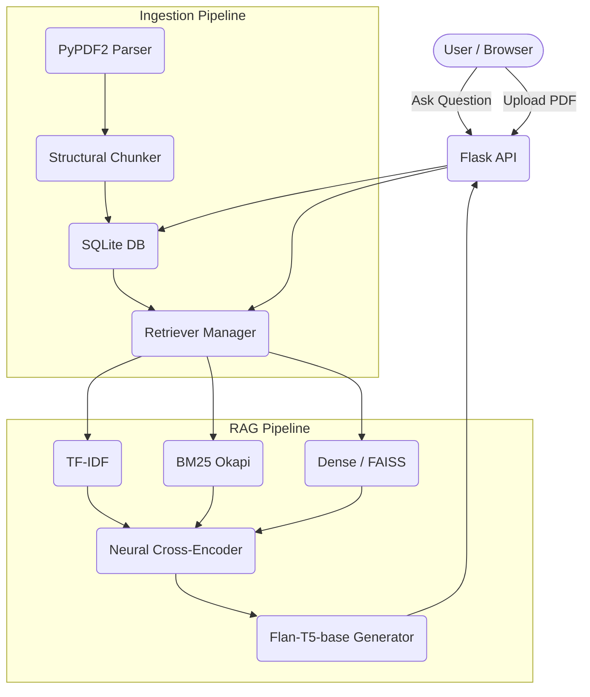

# Enterprise PDF RAG Application Documentation

This document provides a comprehensive and detailed overview of the entire Enterprise PDF Retrieval-Augmented Generation (RAG) application. It covers architecture, chunking strategies, retrieval methods, generation logic, API endpoints, and evaluation tools.

---

## 1. Project Overview & Features
The project is a robust, full-stack **Flask-based application** designed to ingest PDF documents, index their contents, and provide intelligent, AI-generated answers to user queries using the documents as context.

### Key Features:
- **Intelligent Chunking:** Extracts text from PDFs and chunks them based on logical structure/headers, falling back to a sliding window.
- **Multi-Retriever Support:** Implements and orchestrates Dense Embeddings (FAISS), BM25 (Okapi), and TF-IDF baselines.
- **Neural Reranking:** Employs a Cross-Encoder (`cross-encoder/ms-marco-MiniLM-L-6-v2`) to re-score and refine candidate passages.
- **Generative Summarization:** Uses Google's `flan-t5-base` to synthesize direct answers from the reranked context.
- **Exploratory Data Analysis (EDA):** Built-in corpus statistics, word clouds, and chunk distributions using `matplotlib`.
- **Benchmarking & Evaluation:** Automated scripts to measure Precision@K and latency across all three retrievers.

---

## 2. Architecture & Tech Stack

### Tech Stack:
- **Backend Core:** Python 3, Flask, Flask-CORS
- **Database:** SQLite3
- **AI/ML Libraries:** `sentence_transformers`, `transformers`, `torch`, `faiss-cpu`, `rank_bm25`, `scikit-learn`, `PyPDF2`
- **Analytics/Visuals:** `matplotlib`, `wordcloud`, `numpy`

### Architecture Diagram

---

## 3. Database Schema (`db.py`)
The application uses SQLite (`data/pdfs.db`) with two main tables:

| Table | Columns | Purpose |
| :--- | :--- | :--- |
| **pdfs** | `id` (PK), `filename`, `total_pages`, `total_chunks`, `created_at` | Tracks uploaded documents. |
| **chunks** | `id` (PK), `pdf_id` (FK), `chunk_index`, `page_number`, `text`, `token_count` | Stores the extracted text segments. Cascades on PDF delete. |

> [!NOTE]
> Database operations are handled using `sqlite3.Row` for dictionary-like access. A migration function (`migrate_existing_data`) ensures backward compatibility.

---

## 4. Ingestion & Retrieval (`retrieval.py`)

### PDF Parsing & Chunking
- **Parsing:** Uses `PyPDF2` to extract text page-by-page, cleaning up layout artifacts while preserving vertical structure (newlines).
- **Structural Chunking (`chunk_document`):** 
  - Uses Regex (`r'(?:^|\n)(?=[A-Z0-9])([^\n]{2,55}(?<![\,\.\;\-\:]))\n'`) to identify headers and section breaks.
  - If a section exceeds the predefined `chunk_size` (default: 150 words), it falls back to a **sliding window approach** (30-word overlap) strictly within that section.

### Retriever Manager & Engines
The `RetrieverManager` coordinates three distinct retrieval mechanisms, allowing side-by-side comparison:
1. **Dense Retriever:** Uses `SentenceTransformer("all-MiniLM-L6-v2")` mapped into a `faiss.IndexFlatIP` (Cosine Similarity). Stores an `id_map.pkl` to map FAISS indices to DB Chunk IDs.
2. **BM25 Retriever:** Sparse baseline utilizing `rank_bm25.BM25Okapi`. Tokenizes by simple alphanumeric regex.
3. **TF-IDF Retriever:** Baseline using `sklearn.feature_extraction.text.TfidfVectorizer` (unigrams & bigrams, sublinear TF) paired with cosine similarity.

---

## 5. Neural AI Pipeline (`generation.py`)

When a query is received, the `RAGPipeline` executes the following sequence:

1. **Candidate Retrieval:** Fetches Top-K (default 4-5) candidates using the user-specified retriever (Dense, BM25, or TF-IDF).
2. **Neural Reranking:** 
   - Uses `NeuralReranker` powered by `cross-encoder/ms-marco-MiniLM-L-6-v2`.
   - Concatenates the query and candidate chunk, pushing it through the Cross-Encoder for a highly accurate relevance score.
   - Truncates to the absolute best candidates (Top 2-4).
3. **Generative Synthesis:**
   - The `FlanT5Generator` (`google/flan-t5-base`) compresses the highest-scoring chunks into a compact prompt string.
   - Generates a concise, direct answer limiting hallucination using specific decoding parameters (e.g., `num_beams=3`, `repetition_penalty=1.2`).
4. **Formatting:** Assembles the final Markdown payload, injecting sources, page numbers, AI summary, and exact textual context.

---

## 6. Application API Layer (`app.py`)

The Flask app exposes several RESTful endpoints:

| Endpoint | Method | Description |
| :--- | :---: | :--- |
| `/` | `GET` | Renders `index.html` UI. |
| `/api/pdfs` | `GET`, `POST` | Lists all PDFs or uploads/chunks a new PDF. |
| `/api/pdfs/<id>`| `DELETE` | Removes a PDF and its chunks, rebuilding indices. |
| `/api/chunks` | `GET` | Lists and filters chunks in the system. |
| `/api/rebuild` | `POST` | Forces a manual rebuild of FAISS, TF-IDF, and BM25 indices. |
| `/api/query` | `POST` | End-to-end question answering endpoint. |
| `/api/compare` | `POST` | Runs a query against all 3 retrievers simultaneously to compare overlap and latency. |
| `/api/eda` | `GET`, `POST` | Retrieves or triggers corpus analytics. |

---

## 7. Data Analytics & EDA (`eda.py`)

The `eda.py` script computes corpus-level statistics and renders charts using `matplotlib` (configured with `Agg` backend for headless operation).

**Generated Artifacts (Saved to `static/eda/`):**
- `eda_summary.json`: Contains mean/median chunk lengths, total words, and top 20 keywords (excluding standard English & Java stop words).
- `chunk_length_distribution.png`: Histogram of chunk word counts.
- `word_frequency.png`: Horizontal bar chart of domain keywords.
- `wordcloud.png`: Visual representation of corpus vocabulary.

---

## 8. Benchmarking & Evaluation (`evaluate.py`)

A comprehensive evaluation script used to validate pipeline effectiveness.
- **Test Set:** A hardcoded benchmark of 5 Java/Hibernate queries paired with `intent_keywords`.
- **Metrics:** Computes **Precision@1**, **Precision@3**, and **Precision@5** by analyzing keyword overlap in the retrieved chunks. Also logs exact Millisecond Latencies.
- **Visual Outputs:** Generates comparative bar charts for both Latency and Precision@K across Dense, BM25, and TF-IDF methods, saving them alongside `evaluation_results.json`.

---

## 9. Testing Tools
- **`test_pipeline.py`**: A lightweight CLI test script that initializes the DB, builds the `RetrieverManager`, and runs the full `RAGPipeline` (Dense and BM25 + Reranker) natively in the console.
- **`test_extract.py` & `test_prompt.py`**: Associated testing files for isolated testing of the parsing and LLM prompting boundaries.

> [!TIP]
> **Running the Application Manually:**
> To run the application, navigate to the `pdf_rag` directory in your terminal, activate your virtual environment (`.\venv\Scripts\activate`), and execute `python app.py`. The interface will be served at `http://127.0.0.1:5000`.
